<div align="center">


# League Companion

All your League of Legends and Teamfight Tactics accounts in one window: one-click login, live ranks, and now a full profile for every account with stats, owned champions and skins, and what the collection is worth.

[](https://github.com/PourquoiPasMoi/LeagueAccounts/releases/latest)

[](LICENSE)

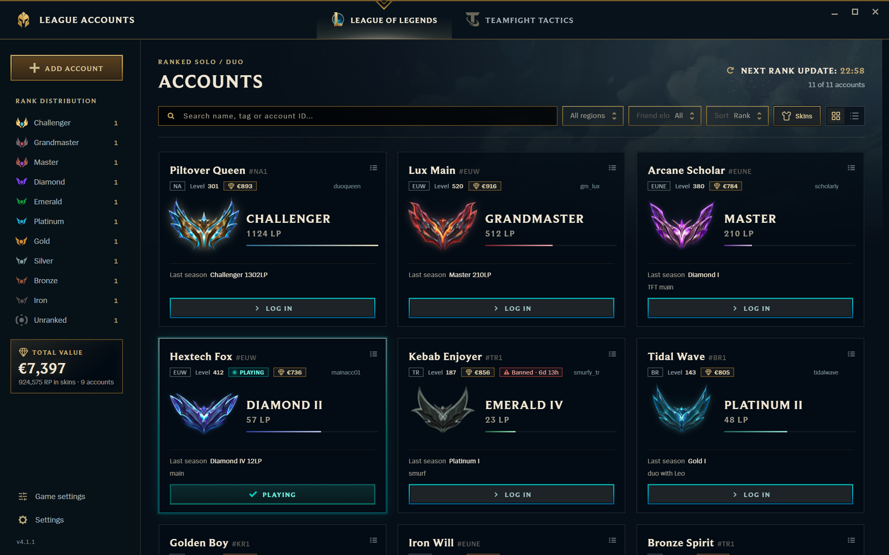

</div>

## Where this comes from

This project is a fork of [League Accounts by Tariolle](https://github.com/Tariolle/LeagueAccounts). The account manager itself is their work: the Riot Client login, OP.GG rank tracking, ban detection, Credential Manager storage, the League client look and the six translations. If you only need a fast account switcher, their version is excellent and you should go star it.

This fork, now called League Companion, adds a profile page for each account and a few things I wanted on top: knowing which account is signed in, finding which account owns a skin, and adding up what all those skins cost.

## What's new in this fork

### A profile for every account

Double-click a card (or press Enter, or use Profile in the card menu) and the account opens full screen, styled like the League client. The page also opens by itself after you log in.

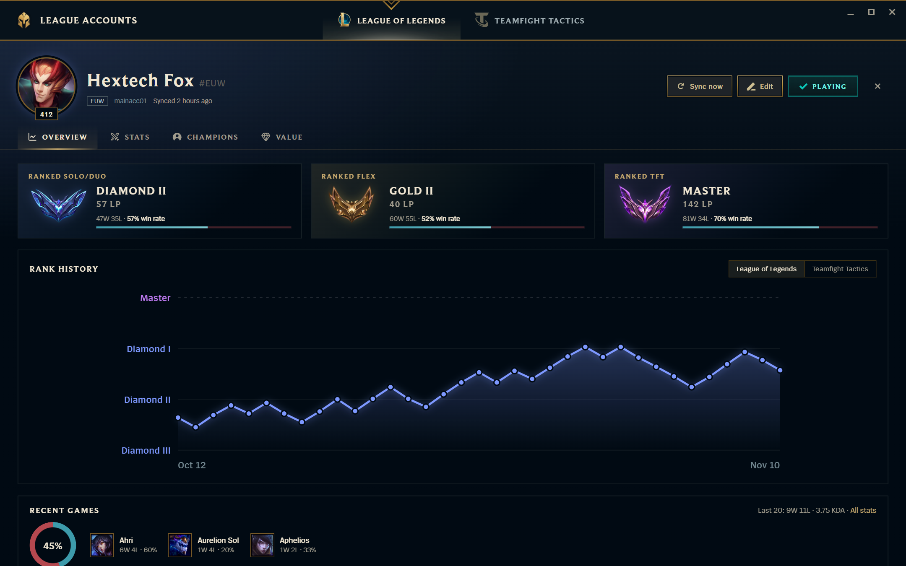

The overview shows Solo/Duo, Flex and TFT ranks with wins, losses and win rate, a rank history chart, and your recent games. Hover any point on the chart to read the exact rank, LP and the change since the previous point. Zoom from all games down to the last week (buttons or Ctrl + scroll) to see each division; the zoom is remembered.

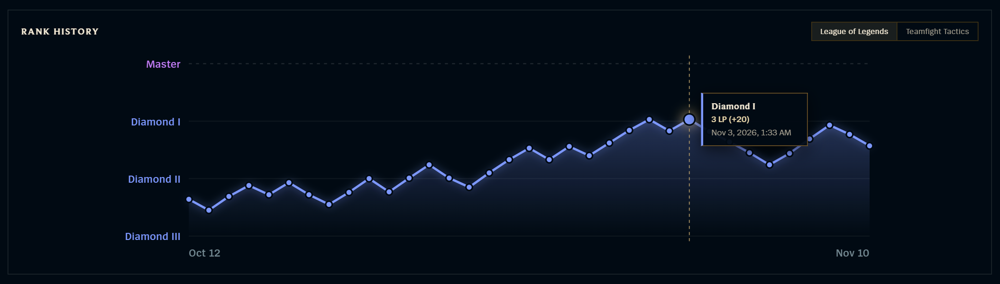

### Stats that grow over time

The Stats tab works from a game archive that fills up on its own. Every rank refresh saves the last games listed on the account's OP.GG page, so accounts you never open still get data. Each login through the app adds up to 50 games with full detail from the League client: damage, gold, vision, wards, kill participation, share of team damage, role and multikills. Up to 3,000 games are kept per account.

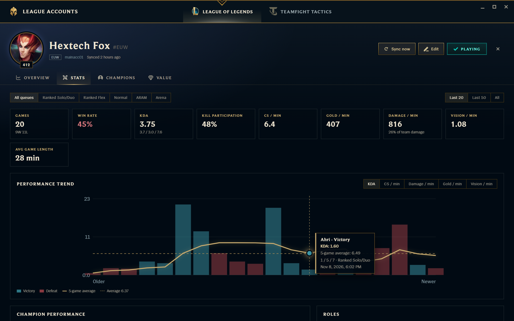

You can filter by queue (Solo/Duo, Flex, Normal, ARAM, Arena) and by the last 20, last 50 or all games. The page shows win rate, KDA, kill participation, CS, gold, damage and vision per minute, average game length and OP Score. The trend chart plots one bar per game with a five-game average; switch it between KDA, CS, damage, gold and vision, and hover a bar to see that game.

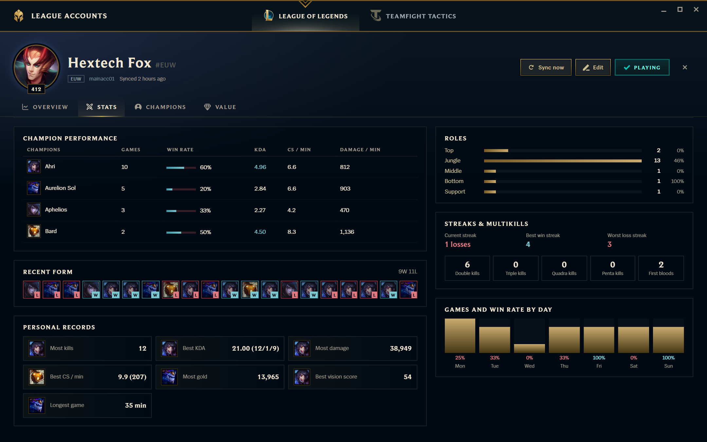

Below that: performance per champion, your recent form, personal records (most kills, best KDA, most damage, best CS per minute and more), roles, streaks and multikills, and how you do on each day of the week.

### Champions and skins you own

The Champions tab lists every champion the account owns, with mastery and skin count. Search by champion or skin name, sort by mastery, skins or name, and click a champion to see only the skins that account owns, with their RP price and chromas.

<table>
  <tr>
    <td width="50%">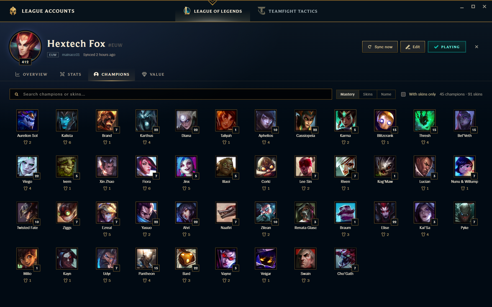</td>
    <td width="50%">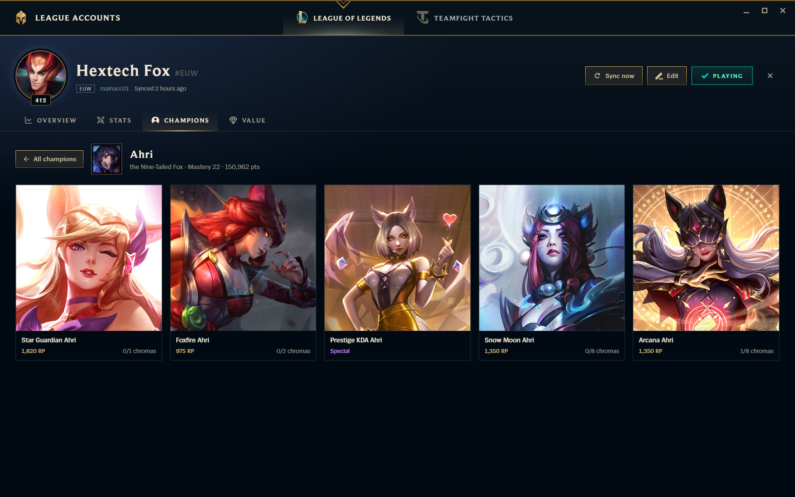</td>
  </tr>
</table>

### What each account is worth

The Value tab adds up the RP price of every owned skin and converts it to euros. You set the rate in Settings (125 RP per euro by default). Prestige, reward and event skins were never sold for RP, so they are counted separately and left out of the total. Each card on the main screen shows its account's value, and the sidebar shows the total for all accounts.

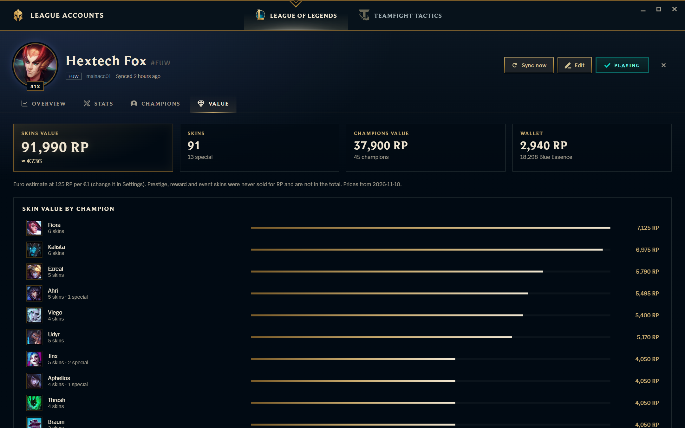

### Skin finder

Want to play a specific skin? Open Skins in the toolbar, type part of the name, and you get every account that owns it, with a Log in button next to each.

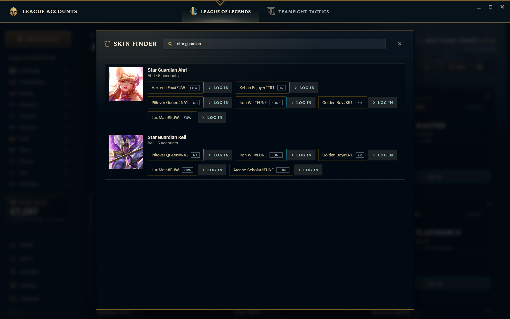

### The same game settings on every account

League replaces your settings and keybinds with each account's cloud copy when you sign in. A common fix is to make `Config\PersistedSettings.json` read-only so every account keeps the same setup, but then changing anything means unlocking the file, editing it, and locking it again.

Game settings in the sidebar does that for you. It shows your hotkeys as keycaps (click one and press the new key; duplicate keys turn red), sound sliders with mute buttons, interface, game and accessibility options, plus a searchable list of every value in the file. Apply backs up the file, writes your changes, mirrors them into `game.cfg` and `input.ini`, and locks the file again. Undo last apply puts the previous version back.

<table>
  <tr>
    <td width="50%">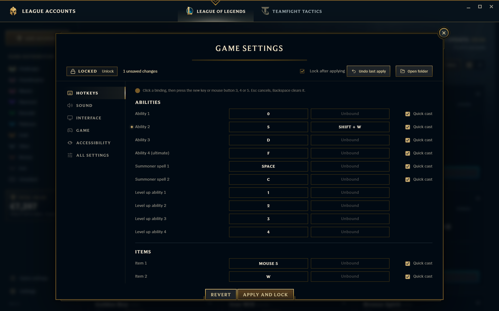</td>
    <td width="50%">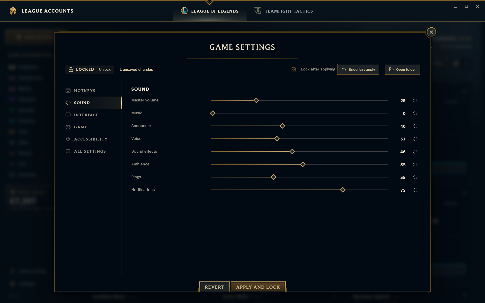</td>
  </tr>
</table>

### Experimental: champ select and live game assistant

Off by default. Turn it on in Settings › Experimental. It is still under development, so expect changes and rough edges; with it off, the app is the account manager and stats described above.

- In champ select, the build page opens with OP.GG's runes, summoner spells and one 6-item build adapted to the enemy team. Apply puts the rune page, spells and item set into the client (only through the League client's own local API, like other build apps), and the item set is the one the shop shows first.
- When the game starts, the page switches to a live view of both teams: champions, ranks, team composition, K/D/A, kill participation, CS per minute, vision, items and objectives. It reads only Riot's local live game data; nothing is drawn over or injected into the game.

### Smaller changes

- Closing the window keeps the app in the system tray; quit from the tray icon's menu.
- The account that is signed in right now gets a teal frame and a Connected or Playing badge, and its Log in button is disabled.
- The selected card has an animated gold frame, and rank crests glow in their tier color.
- Champion and skin pictures are downloaded the first time you see them and then load from disk.

## Everything from the original

- One-click login: the app opens the Riot Client, signs in and launches LoL or TFT.
- LoL and TFT ranks from OP.GG, refreshed in the background (every 30 minutes by default).
- The Friend elo filter shows which accounts can play ranked with a friend.
- Each login reads the account's League ban, and a banned account shows the time left.
- Passwords stay in Windows Credential Manager and never reach the interface.
- Launch with Windows, keyboard shortcuts, import and export, automatic updates, six languages and interface sizes from 80 to 200%.

<table>
  <tr>
    <td width="50%">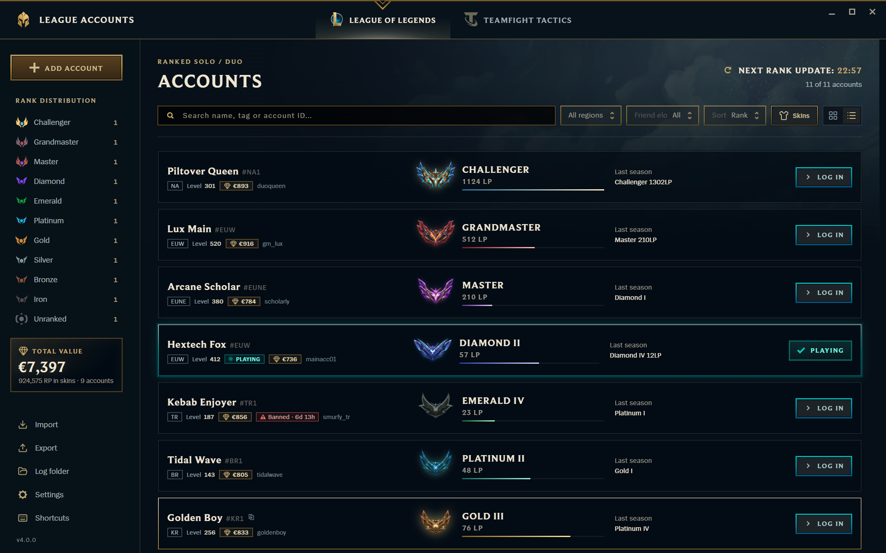<br /><sub>List view for many accounts.</sub></td>
    <td width="50%">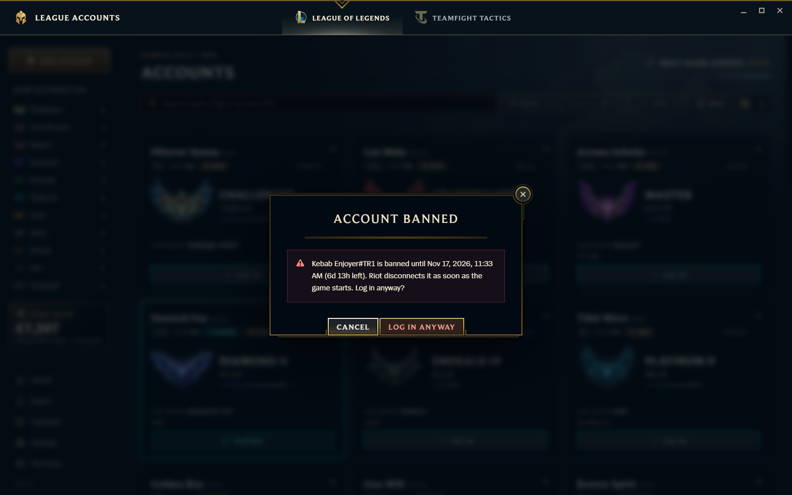<br /><sub>See how long a ban lasts before you log in.</sub></td>
  </tr>
  <tr>
    <td>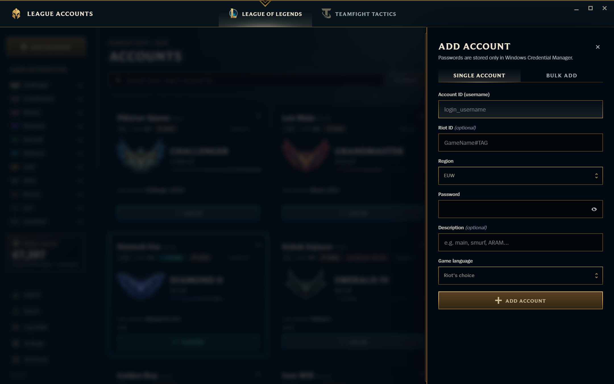<br /><sub>Add one account or paste many.</sub></td>
    <td>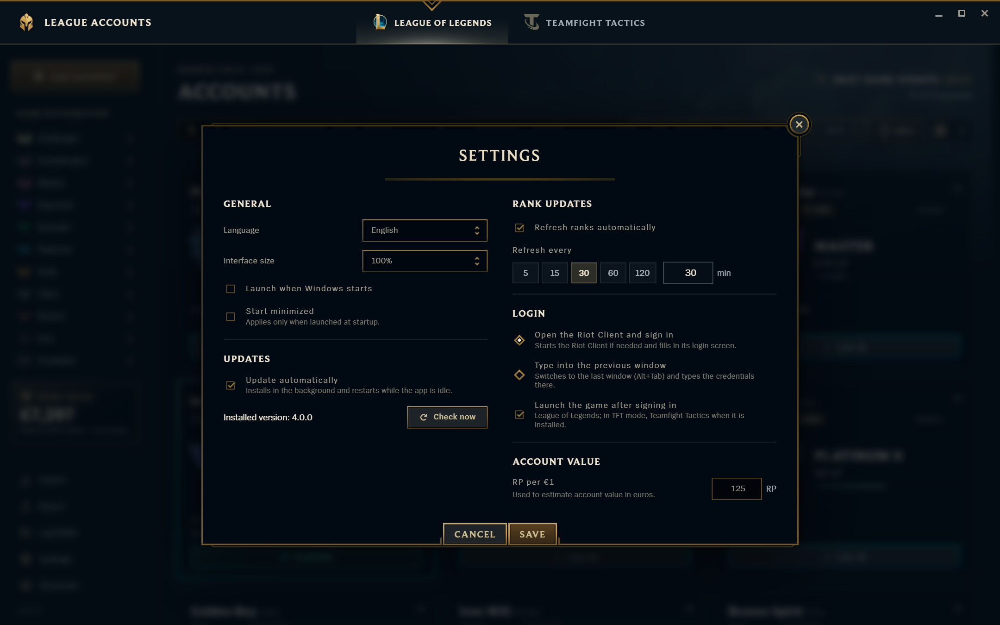<br /><sub>Settings, including the RP to euro rate.</sub></td>
  </tr>
</table>

## Installation

1. Download `LeagueAccounts.exe` from the [latest release](https://github.com/PourquoiPasMoi/LeagueAccounts/releases/latest).
2. Put it in a folder of your own, such as `Documents\LeagueAccounts` (not `Program Files`, so it can update itself), and run it.
3. The exe is not code-signed. If SmartScreen says "Windows protected your PC", click More info, then Run anyway.

You need Windows 10 or 11 with [WebView2](https://developer.microsoft.com/microsoft-edge/webview2/), which current Windows already has. Updates come from this repository's releases; you can turn them off in Settings.

Already using the original app? Close it and run this exe instead. It reads the same saved accounts from `%APPDATA%\LeagueAccounts`, so there is nothing to set up again.

## Usage

Add accounts with Add account (`Ctrl+N`): the Riot Client username, password, region and, optionally, the Riot ID (`Name#TAG`) used to look up ranks. To add many at once, paste one per line in Bulk add:

```text
username1--Player One#EUW--password1
username2--password2
```

Log in with the card's Log in button. If another account is signed in, it is signed out first, and you're warned before an open League client is closed or a match is left. For 2FA or a captcha, finish in the Riot window and the game launches once the sign-in is confirmed.

To fill an account's profile, log in to it once through the app with "Launch the game after signing in" turned on. Owned champions and skins only exist in the League client, so the app reads them while that account is signed in. If League is already open on an account, press Sync now on its page.

<details>
<summary>Keyboard shortcuts</summary>

| Shortcut | Action |
|---|---|
| `Ctrl+Shift+V` | Log in with the selected account |
| `Enter` / double-click | Open the selected account's profile |
| `Ctrl+C` | Copy the account ID (press again for the password) |
| `↑ ↓ ← →` | Move between accounts |
| `Delete` | Delete the selected account (asks first) |
| `Ctrl+F` / `Ctrl+N` / `Ctrl+,` | Search / Add account / Settings |
| `Ctrl+R` / `F5` | Refresh ranks |
| `Ctrl+1` / `Ctrl+2` | League of Legends / TFT mode |
| Right-click | All actions |

</details>

## Privacy and security

- Passwords are stored in Windows Credential Manager (service `LeagueAccounts`), never in the app's files. Copied passwords are cleared from the clipboard after 30 seconds and kept out of clipboard history.
- Exports contain passwords in plain text. Keep them private.
- The app contacts OP.GG for ranks and recent games, the Riot and League clients on `127.0.0.1`, CommunityDragon for champion and skin pictures, and GitHub for updates. There is no telemetry and no account server.
- Accounts, settings, profiles, game history, cached pictures, game settings backups and logs live in `%APPDATA%\LeagueAccounts\`. Logs hold fixed event codes only, never account data.
- Game settings only touches `PersistedSettings.json`, `game.cfg` and `input.ini` in League's Config folder, and backs the settings file up before every change.

## Troubleshooting

| Problem | What to do |
|---|---|
| The profile says it was never synced | Log in to that account through the app with game launch on, or open League on it and press Sync now. |
| Stats only show a few games | Games build up over time: 10 or so from OP.GG per refresh, and up to 50 per login. |
| *Riot Client was not found* | Install the Riot Client, or use Settings, Login, Type into the previous window. |
| Ranks show Unavailable or *Riot ID not found* | Check the Riot ID and region; OP.GG may also be rate limiting. |
| Shown online while using [Deceive](https://github.com/molenzwiebel/Deceive) | Start Deceive first, then log in with League Accounts. |
| Anything else | Attach the newest file from Settings, Log folder to an [issue](https://github.com/PourquoiPasMoi/LeagueAccounts/issues). |

## Building from source

You need [Rust](https://rustup.rs) (MSVC toolchain), [Node.js](https://nodejs.org) 20 or newer, and the Visual Studio C++ Build Tools.

```bash
npm install
npx tauri build --no-bundle
```

The exe ends up in `target/release/LeagueAccounts.exe`. Skin prices come from Meraki Analytics' community data; `node scripts/skin-prices.mjs` refreshes them after new skins come out.

## License and disclaimer

Code under the [MIT License](LICENSE), which also covers the original work by [Tariolle](https://github.com/Tariolle/LeagueAccounts). Bundled Riot Games artwork, fonts and animations keep their original rights; see [THIRD_PARTY_ASSETS.md](THIRD_PARTY_ASSETS.md).

League Accounts isn't endorsed by Riot Games and doesn't reflect the views or opinions of Riot Games or anyone officially involved in producing or managing Riot Games properties. Riot Games, League of Legends and Teamfight Tactics are trademarks or registered trademarks of Riot Games, Inc. Rank data and recent games come from OP.GG, skin prices from Meraki Analytics and pictures from CommunityDragon; this project is not affiliated with any of them. Sharing accounts may be against Riot Games' Terms of Service; you are responsible for how you use this tool.
